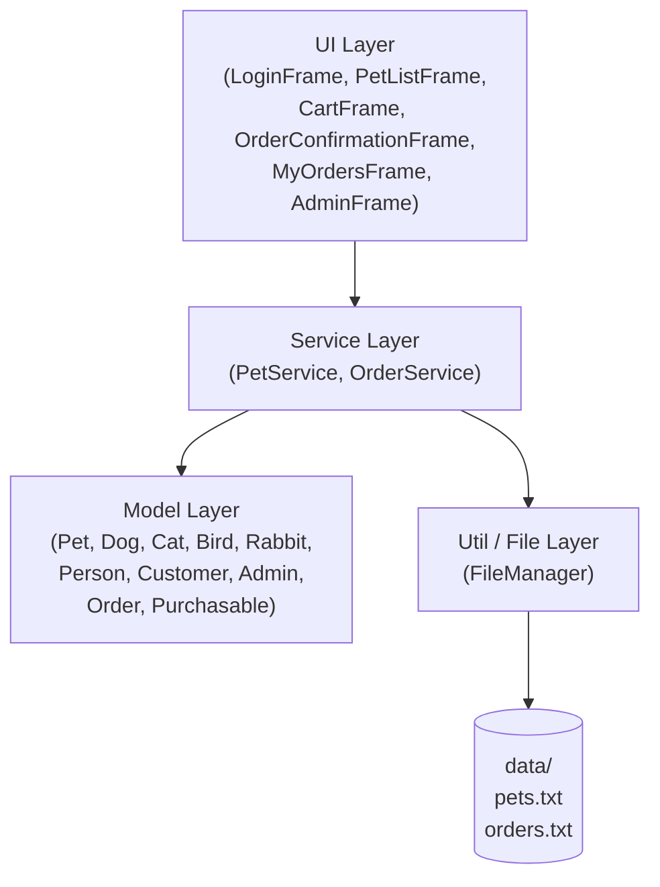

# Pet Shop Management System 🐾

A Java Swing desktop application for managing a pet shop. Built as a college mini-project for the course **22IT321 Object-Oriented Programming**.

---

## 1. Project Overview

The **Pet Shop Management System** is a GUI desktop application built entirely in pure Java (JDK 17+) with Swing (JFrame). It provides two user roles:

| Role     | Access                                                              |
|----------|----------------------------------------------------------------------|
| Customer | Browse pets, add to cart, purchase, view and cancel their orders    |
| Admin    | Add / update / remove pets, view all pets, view all customer orders |

**Technology Stack:**
- Language: Java 17+
- GUI: Java Swing (JFrame, JTable, JDialog, JOptionPane)
- Storage: Plain CSV text files (`data/pets.txt`, `data/orders.txt`)
- Build: `javac` + `jar` (no Maven/Gradle)

---

## 2. Features

### Customer Features
- Login with name and phone number
- Browse all pets in a sortable JTable
- View individual pet details
- Add available pets to a shopping cart
- Remove pets from the cart
- Confirm purchase with order summary
- View all past orders
- Cancel an order (pets become available again)

### Admin Features
- Login with fixed password (`admin123`)
- View all pets (available + sold)
- Add a new pet (Dog, Cat, Bird, Rabbit)
- Update existing pet details and price
- Remove a pet from the system
- View all customer orders in a JTable

---

## 3. Architecture

The application uses a layered architecture:

```
UI Layer  →  Service Layer  →  Model Layer  →  FileManager / data/
```

### Mermaid Architecture Diagram



### Package Responsibilities

| Package              | Responsibility                                              |
|----------------------|--------------------------------------------------------------|
| `com.petshop`        | Entry point (`Main.java`)                                   |
| `com.petshop.model`  | Domain objects: `Pet`, `Dog`, `Cat`, `Bird`, `Rabbit`, `Person`, `Customer`, `Admin`, `Order`, `Purchasable` |
| `com.petshop.service`| Business logic: `PetService` (CRUD + total calc), `OrderService` (purchase, cancel, SwingWorker save) |
| `com.petshop.util`   | `FileManager` — CSV read/write for pets and orders          |
| `com.petshop.exception` | Custom exceptions: `PetNotAvailableException`, `InvalidInputException` |
| `com.petshop.ui`     | Swing frames: `LoginFrame`, `PetListFrame`, `CartFrame`, `OrderConfirmationFrame`, `MyOrdersFrame`, `AdminFrame` |

---

## 4. Implementation Details

### Key Classes

| Class | Responsibility |
|-------|---------------|
| `Main` | Starts the Swing EDT and shows `LoginFrame` |
| `Person` | Abstract class with `name`, `phoneNumber`, abstract `getRole()` |
| `Customer` | Extends `Person`; holds `customerId`; overrides `getRole()` |
| `Admin` | Extends `Person`; validates password statically |
| `Pet` | Abstract class implementing `Purchasable`; holds all pet fields; abstract `getAnimalType()` and `getPetDetails()` |
| `Dog / Cat / Bird / Rabbit` | Concrete pets; override `getAnimalType()` and `getPetDetails()` |
| `Order` | Holds orderId, customerId, list of pets, total, date, status |
| `Purchasable` | Interface with `purchase()`, `cancelPurchase()`, `isAvailable()` |
| `PetService` | Manages `ArrayList<Pet>`; `addPet`, `updatePet`, `removePet`, overloaded `calculateTotal()` |
| `OrderService` | Manages `HashMap<String, Order>`; `purchasePets()` (synchronized), `cancelOrder()`, `saveInBackground()` via SwingWorker |
| `FileManager` | Static read/write of CSV files using `BufferedReader`/`BufferedWriter` with try/catch/finally |

### Pet Purchase Workflow

```
Customer selects pets → Cart → Order Confirmation
→ OrderService.purchasePets() (synchronized)
  → Validates availability (throws PetNotAvailableException if sold)
  → Pet.purchase() (synchronized on pet)
  → Creates Order, stores in HashMap
  → saveInBackground() via SwingWorker
→ Confirmation dialog shown
```

### Pet Availability

- Each `Pet` has a `boolean available` field.
- When purchased: `available = false`, `soldToCustomerId` is set.
- When order cancelled: `available = true`, fields cleared.
- Stored in `pets.txt` and reloaded at startup.

### Cart & Total Price

- `List<Pet> cart` in `PetListFrame`.
- `PetService.calculateTotal(List<Pet>)` — overloaded version 1.
- `PetService.calculateTotal(List<Pet>, double discountPercent)` — overloaded version 2.

### Order Generation & Cancellation

- Order ID: `"ORD" + timestamp % 100000 + 3-digit random`.
- Orders stored in `HashMap<String, Order>`.
- Cancellation marks order status `CANCELLED` and restores pet availability.

### Data Loading & Saving

- `FileManager.ensureDataFiles()` creates `data/pets.txt` and `data/orders.txt` if missing.
- `savePets()` / `loadPets()` — CSV format, one pet per line.
- `saveOrders()` / `loadOrders()` — CSV format, one order per line.
- Saved on every change via `SwingWorker` and on window close via `WindowListener`.

### File Formats

**pets.txt** (one pet per line):
```
P001,Bruno,Dog,German Shepherd,12,Male,15000.00,true,,
P004,Whiskers,Cat,Persian,6,Female,10000.00,false,C1234,ORD567890123
```
Columns: `petId,name,animalType,breed,age,gender,price,available,soldToCustomerId,orderId`

**orders.txt** (one order per line):
```
ORD567890123,C1234,Alice,9876543210,P004|P007,12500.00,2026-11-21 10:30:00,CONFIRMED
```
Columns: `orderId,customerId,customerName,customerPhone,petIds(pipe-sep),totalAmount,orderDate,status`

### SwingWorker & Synchronized

- `OrderService.saveInBackground()` creates a `SwingWorker<Void,Void>` that calls `FileManager.saveOrders()` and `petService.savePets()` on a background thread — GUI never freezes.
- `OrderService.purchasePets()` is `synchronized` to prevent two simultaneous purchases.
- `Pet.purchase()` is `synchronized` to prevent the same pet being sold twice.

### Exception Handling

| Exception | Thrown When |
|-----------|-------------|
| `PetNotAvailableException` | Pet is already sold (purchase attempt) |
| `InvalidInputException` | Blank name, invalid price, duplicate pet ID, etc. |

All file I/O uses `try { ... } catch (IOException e) { ... } finally { close(); }`.

---

## 5. OOP Concepts

| Concept | Class / File | Implementation |
|---------|-------------|----------------|
| Encapsulation | All model classes | Private fields + public getters/setters |
| Abstraction (abstract class) | `Person.java`, `Pet.java` | Abstract classes with abstract methods |
| Abstraction (interface) | `Purchasable.java` | Interface with `purchase()`, `cancelPurchase()`, `isAvailable()` |
| Inheritance | `Customer`, `Admin` → `Person` | `extends Person` |
| Inheritance | `Dog`, `Cat`, `Bird`, `Rabbit` → `Pet` | `extends Pet` |
| Polymorphism (overriding) | `Customer.getRole()`, `Admin.getRole()` | Override `Person.getRole()` |
| Polymorphism (overriding) | `Dog.getPetDetails()`, `Cat.getPetDetails()`, `Bird.getPetDetails()` | Override `Pet.getPetDetails()` |
| Polymorphism (overloading) | `PetService.calculateTotal()` | Two versions: with and without discount |
| Exception Handling | `PetNotAvailableException`, `InvalidInputException` | Custom checked exceptions |
| Exception Handling | `FileManager`, `OrderService`, UI frames | try/catch/finally; JOptionPane for errors |
| Threading | `OrderService.saveInBackground()` | SwingWorker for background file saves |
| Threading | `Pet.purchase()`, `OrderService.purchasePets()` | `synchronized` methods |
| File Handling | `FileManager.java` | BufferedReader/Writer, CSV, try/catch/finally |
| Collections | `PetService` | `ArrayList<Pet>` for pet records |
| Collections | `OrderService` | `HashMap<String, Order>` for orders |
| Collections | `PetListFrame` | `List<Pet>` for cart; `Set<String>` for sold IDs |
| Event Handling | All UI frames | `ActionListener` on buttons |
| Event Handling | `PetListFrame`, `MyOrdersFrame`, `AdminFrame` | `ListSelectionListener` on JTables |
| Event Handling | All frames | `WindowListener` for save-on-close |

---

## 6. How to Run

### Prerequisites

- **Java JDK 17 or later** installed.
- Verify: `java -version` and `javac -version`.

### Windows PowerShell — Compile & Run

```powershell
# Compile
Get-ChildItem -Recurse -Filter "*.java" src | ForEach-Object { $_.FullName } | Out-File sources.txt
javac -d out -sourcepath src (Get-Content sources.txt)

# Run
java -cp out com.petshop.Main
```

### Windows — Using run.bat

```bat
run.bat
java -jar PetShop.jar
```

### Linux / macOS — Using run.sh

```bash
chmod +x run.sh
./run.sh
java -jar PetShop.jar
```

### JAR Execution

```
java -jar PetShop.jar
```

> [!IMPORTANT]
> Run from the project root directory so that the `data/` folder is found correctly.

### Admin Password

```
admin123
```

---

## 7. Folder Structure

```
petshop/
├── src/
│   └── com/
│       └── petshop/
│           ├── Main.java
│           ├── model/
│           │   ├── Person.java
│           │   ├── Customer.java
│           │   ├── Admin.java
│           │   ├── Pet.java
│           │   ├── Dog.java
│           │   ├── Cat.java
│           │   ├── Bird.java
│           │   ├── Rabbit.java
│           │   ├── Order.java
│           │   └── Purchasable.java
│           ├── service/
│           │   ├── PetService.java
│           │   └── OrderService.java
│           ├── util/
│           │   └── FileManager.java
│           ├── exception/
│           │   ├── PetNotAvailableException.java
│           │   └── InvalidInputException.java
│           └── ui/
│               ├── LoginFrame.java
│               ├── PetListFrame.java
│               ├── CartFrame.java
│               ├── OrderConfirmationFrame.java
│               ├── MyOrdersFrame.java
│               └── AdminFrame.java
├── data/
│   ├── pets.txt
│   └── orders.txt
├── docs/
│   ├── requirements.md
│   ├── class_diagram.md
│   ├── package_diagram.md
│   ├── oop_concepts.md
│   ├── sample_output.md
│   └── screenshots/
├── report/
│   └── PetShop_Report.docx
├── tools/
│   └── CaptureScreens.java
├── out/            (generated — not committed)
├── PetShop.jar     (generated)
├── run.bat
├── run.sh
├── .gitignore
└── README.md
```

---

## 8. Screenshots

Screenshots are located in `docs/screenshots/`. Run the application and use `tools/CaptureScreens.java` to auto-generate PNGs.

---

## 9. GitHub

[https://github.com/Jeyaprakash-02/Pet-Shop](https://github.com/Jeyaprakash-02/Pet-Shop)
