# Sample Output — Pet Shop Management System

> Screenshots captured from the running application.  
> Location: `docs/screenshots/`

---

## 1. Login Screen (Customer/Admin Selection)

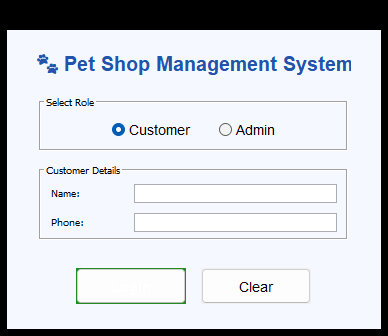

*The login window with Customer selected. Customer enters name and phone number.*

---

## 2. Admin Login

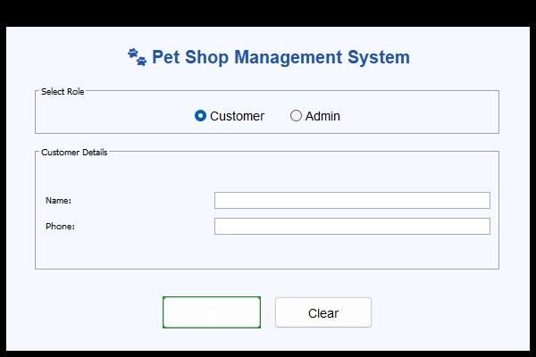

*Admin radio button selected; password field visible.*

---

## 3. Pet List (Customer View)

*All available and sold pets displayed in a JTable with status column.*

---

## 4. Pet Details Panel

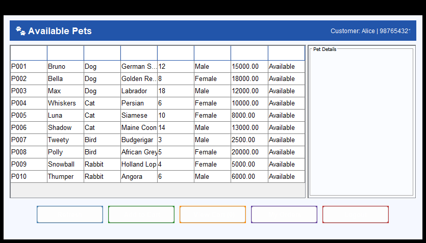

*Clicking a row in the table shows the selected pet's full details in the right panel.*

---

## 5. Shopping Cart

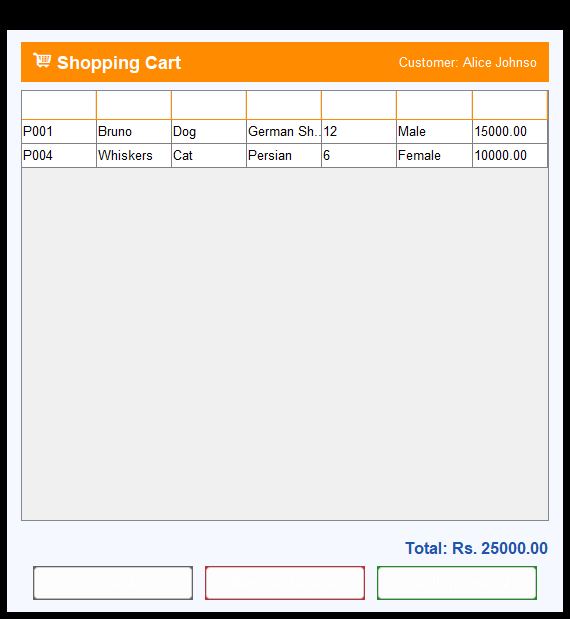

*Selected pets in the cart with total amount calculated at the bottom.*

---

## 6. Order Confirmation Summary

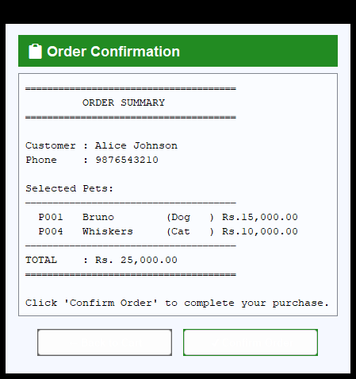

*Order summary showing customer name, pet IDs, individual prices, and total.*

---

## 7. Order Confirmation Dialog

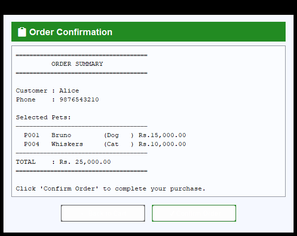

*Popup dialog after successful purchase showing Order ID and total amount.*

---

## 8. My Orders

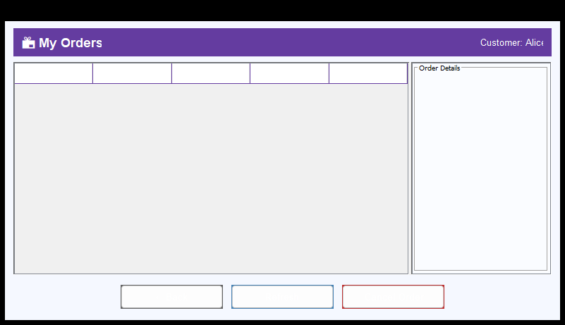

*Table of the customer's past orders with status (CONFIRMED / CANCELLED).*

---

## 9. Order Cancellation

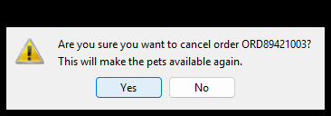

*Confirmation dialog before cancelling an order.*

---

## 10. Admin Panel — Manage Pets

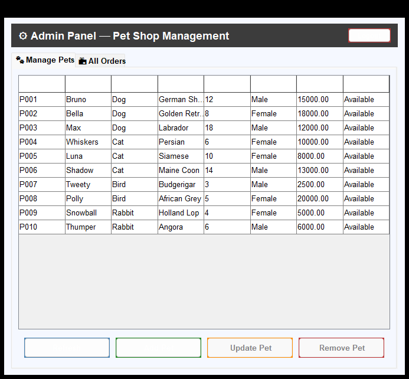

*Admin panel showing all pets in JTable with Add / Update / Remove buttons.*

---

## 11. Add Pet Dialog

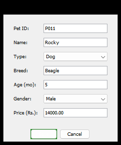

*Dialog for adding a new pet with all required fields.*

---

## 12. Update Pet Dialog

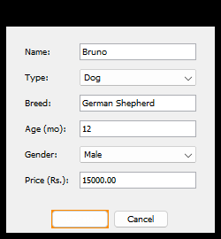

*Dialog for updating an existing pet's details.*

---

## 13. Admin Orders Table

*All orders across all customers shown in the Orders tab.*

---

## 14. Error — Pet Not Available

*Error dialog shown when a customer tries to add an already-sold pet to the cart.*

---

## 15. Error — Invalid Input

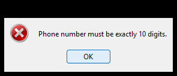

*Error dialog shown when the customer submits a blank name or invalid phone number.*
